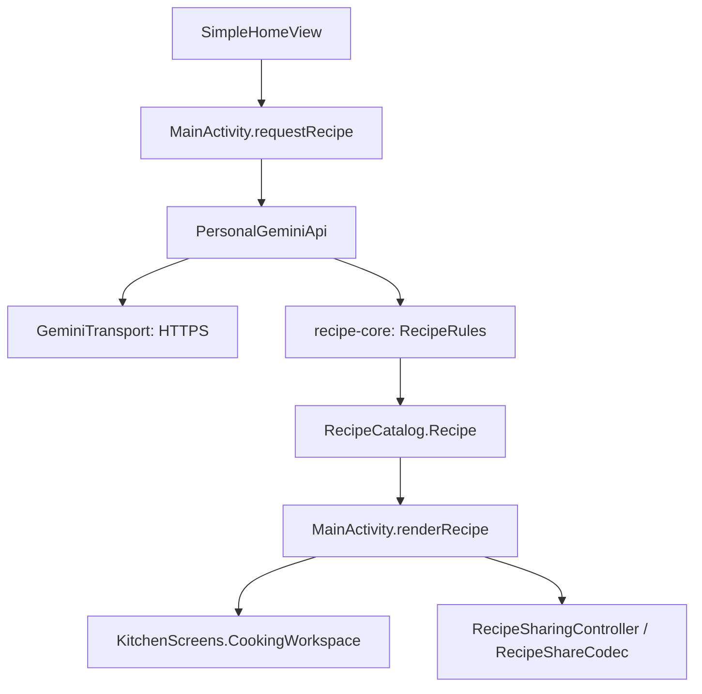

# Tabkha code guide

This guide describes the native Android app in v1.9.0. Start in `app/src/main/java/com/example/dishroulette`. The `recipe-core` module contains platform-independent rules shared with the optional `backend` service. The installed Android app calls Gemini directly; it does not require that service.

## A short explanation for someone new

1. Home collects pantry ingredients and recipe preferences.
2. MainActivity takes a snapshot of those choices and starts a cancellable recipe request.
3. The provider response passes through shared recipe validation before becoming a Recipe.
4. The result can be saved, shared offline or opened in the cooking workspace.
5. Settings changes language and appearance. Saved bilingual recipes select their display text locally.

## Responsibilities and useful entry points

| Class | Responsibility | Start reading here |
| --- | --- | --- |
| MainActivity | Screen coordination, lifecycle, request state and persistence | `onCreate`, `requestRecipe`, `renderRecipe` |
| SimpleHomeView | Home construction, responsive layout and control updates | constructor, `onMeasure`, `refresh` |
| PantryEntries | Ingredient slots, selection, validation and snapshots | `edit`, `validationError`, `firstEmptySlot` |
| PantryController | Notifies the activity when pantry state changes | `entries`, `restore` |
| RecipePreferences | Stored user choices and exclusion checks | `load`, `copy`, `blocks` |
| RecipePreferencesDialog | Edits a private draft and validates Apply | `show`, `validateDraft`, `applyDraft` |
| KitchenScreens | Saved, Settings and guided cooking screens | `saved`, `settings`, `cook` |
| CookingInstructions | Pure English/Arabic step and duration parsing | `steps`, `suggestedMinutes` |
| RecipeText | Localized overview, time/serving metadata and nutrition | `overview`, `meta`, `nutrition` |
| CookingTimerView | Draws the circular countdown | `onDraw` |
| PersonalGeminiApi | Cancellable recipe request and response conversion | `suggest`, inner Suggestion class |
| GeminiTransport | Shared client, request headers, response limits and status mapping | `generateRequest`, `readBody` |
| PhotoIngredientsController | Camera/picker, preview, recognition and review lifecycle | `open`, `acceptPhoto`, `analyze`, `showReview` |
| IngredientPhoto / PhotoIngredientApi | Image preparation / recognition request | `prepare` / `analyze` |
| RecipeSharingController | Share/import dialogs and historical recipe translation | `prepare`, `share`, `importCode` |
| RecipeShareCodec | Bounded, versioned offline recipe code | `encode`, `decode` |
| RecipeTranslationClient | One-time translation of old single-language recipes | `translate` |
| RecipeCatalog.Recipe | Recipe facts and language selection | `forLanguage` |
| RecipeOptions (recipe-core) | Canonical meal, goal, cuisine and allergy choices | constants |
| RecipeRules / RecipeTranslation (recipe-core) | Provider schema and bilingual content validation | validation and schema methods |
| GeminiCredentials | Encrypted personal connection storage and provisioning | read/write/setup methods |
| UiColors / UiTypography / UiIcons / UiAudio | Shared palette, text, official icon styling and optional sounds | small focused methods |

## Follow the code in small pieces

### Activity setup

`MainActivity.onCreate` establishes the root view and system insets, restores choices and pantry data, creates screen controllers and Back handling, creates Home, then restores the visible screen. Photo activity-result launchers register early in the activity lifecycle. `onSaveInstanceState` retains transient state; `onDestroy` cancels requests and releases controllers, timers and audio.

### Home updates

Home construction uses `createHeader`, `createWorkspace`, `createPantryControls`, `createPreferencesColumn` and other named sections. `onMeasure` delegates responsive changes to `updateColumnLayout`, `updateNavigationLayout`, `updateCompactLayout` and related methods.

`refresh` updates each section through a short list of methods. Ingredient chips rebuild only when the ingredient slot snapshot changes. Goal buttons are created once; their appearance changes when the selected goal changes. Enabled state always updates, including while generating. Changing servings or goals therefore retains existing focused controls. A recreated activity creates fresh views for its current language and theme.

### Preferences and requests

`RecipePreferences.copy()` makes independent mutable lists. The preferences dialog edits that copy; Cancel discards it. Valid Apply invokes `applyRecipePreferences` to save the changes together. A recipe request also uses a snapshot, keeping its inputs stable while it is running.

`requestRecipe` checks input, starts a request and retains its call identity. Callback guards reject results from cancelled or replaced requests. The API validates a provider response before the activity renders it. Recipe generation, photo recognition and translation share an OkHttp connection pool through `GeminiTransport`; each request reads the current credential and sends it in a header. Response bytes are bounded before decoding. The connection setup probe has its own shorter-timeout client.

### Cooking

`KitchenScreens.cook` checks the available steps and opens a `CookingWorkspace`. That workspace owns the current step and its views, rather than hiding mutable state in callback arrays. `renderStep` coordinates progress, completion, navigation and timer setup. `toggleTimer`, `resetTimer` and `updateCountdown` handle timer state. The screen owner stops scheduled ticks when leaving or disposing the screen; idle and paused timers do not schedule one-second refreshes.

`CookingInstructions` handles parsing without Android views. Arabic vowel marks are normalized for duration recognition while the original recipe text remains unchanged. These are foreground visual timers, without a background alarm.

### Recipe language and sharing

`RecipeTranslation.validate` checks the two typed language entries and returns independent normalized text. `Recipe.forLanguage` explicitly copies recipe facts and replaces only the display text. Quantities, nutrition, identity and progress keys stay stable. Personal explanations authored in another language are cleared as before. Old recipes without a valid pair retain their original text until translation succeeds.

Sharing exports a bounded allowlisted recipe snapshot through `RecipeShareCodec`. It excludes credentials and personal preferences. Import decodes locally, reviews content and applies existing exclusions before saving.

## Compatibility boundaries

Names such as `loaded_ammunition`, `loaded_chamber`, `spin_profile`, `ammunition` and `was_firing` remain in persistence code deliberately. They are historical storage keys, not the names to use for new classes. Renaming them would require an explicit migration. The application ID, serialized recipe fields, saved IDs, cooking keys and encrypted connection format also remain unchanged.

The app still contains a small bilingual recipe library for historical saves and translation compatibility. The optional backend, asset licenses, provisioning scripts and verification documents are intentional project files. Generated builds, caches and private configuration are ignored by Git.

## Making a change

- New recipe option: change `RecipeOptions`, localized labels and relevant validation/schema rules together.
- New Home section: add a named creation method, a refresh method if it changes, and responsive handling only where needed.
- New recipe field: review provider validation, model copying, storage, sharing's allowlist and localized display. `RecipeCopyTest` checks that language selection preserves recipe facts.
- New timer syntax: change `CookingInstructions` and add a focused parsing regression; avoid putting parsing in view callbacks.
- New network flow: reuse the transport where its limits and timeouts apply, and keep cancellation tied to the controller lifecycle.

Use `./tools/format-java.sh` for the checked-in Java style. Set `TABKHA_STUDIO_HOME` if Android Studio is installed outside `$HOME/android-studio`. Formatting expands compressed code without introducing a runtime dependency.

Run JVM tests, debug/release builds and lint with the commands in README. Use the dedicated emulator for instrumentation: fixtures deliberately replace preferences, saved recipes and test credentials. Owner USB provisioning should run after fixture tests. Live connection tests are opt-in and use provider quota.
